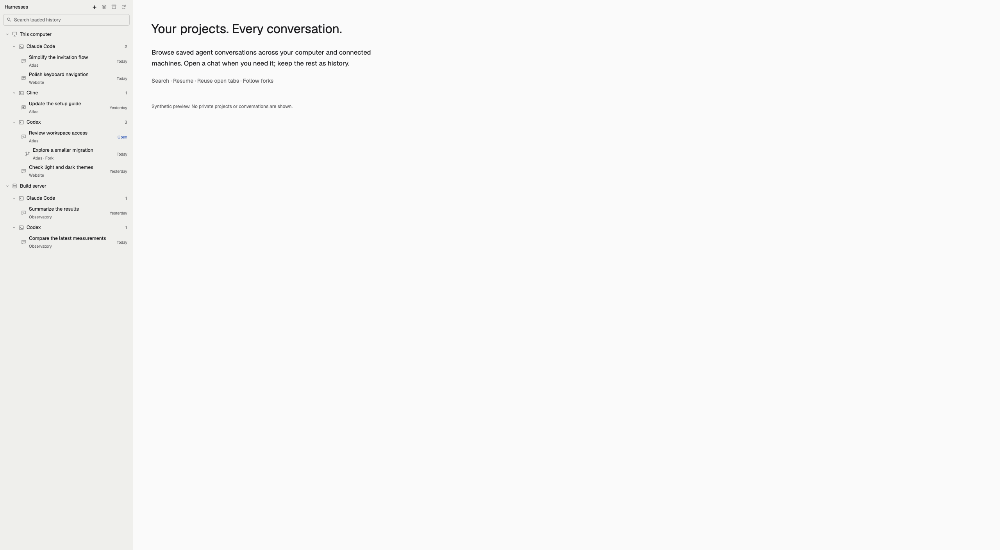

# Herdr Project History

Browse coding-agent projects and saved conversations from a native Herdr sidebar. Open a conversation in its original folder and machine, or return to its existing terminal.

Choose either view:

- Machine → Project → Conversations
- Machine → Harness → Conversations

The panel reads Codex, Claude Code and Cline history where those tools are available. It also shows local Claude Desktop Code metadata that can be matched to CLI sessions. Herdr's separate Agents panel keeps track of running work.



Version: **0.1.0**. See [CHANGELOG.md](CHANGELOG.md) for release notes.

## Prerequisites

- A running Herdr app. Tested with app 0.1.15 and core 0.1.20.
- The `herdr-app` command available in your terminal.
- Python 3.11 or later on each machine whose history you want to browse.
- Each agent installed and signed in through its own tools.
- Remote machines already configured and connected in Herdr.
- For Claude history, the optional Python SDK described below.

The tested platforms are macOS and Linux ARM64. Windows support has not been verified. Development tests also need Node.js 20 or later; the recorded test run used Node.js 26 and Python 3.13.

## Install

Clone the repository and run the installer from its directory:

```sh
git clone https://github.com/coloboxp/herdr-project-history.git
cd herdr-project-history
herdr-app status
python3 -B install.py
```

The installer validates the mod and copies `mods/project-history` into Herdr's app home. It clones the active layout as `<layout>-projects`, replaces the clone's Spaces block, sets an initial sidebar width of 300 px, and switches to the clone. The original layout remains available. The installer prints the new layout name and the original layout name for rollback.

The active layout must contain one Spaces block. If its structure is ambiguous or the clone name already exists, the installer explains how to proceed. For manual integration, copy `mods/project-history` into Herdr's `mods` directory and add this block to a personal layout:

```json
{"id":"projects","type":"block","content":{"mod":"project-history"},"size":{"weight":2},"min":120}
```

Keep the existing Agents, toolbar and terminal blocks. Below 160 px, the history panel becomes a compact space-switching rail.

Herdr mods run with your access. This mod reads agent metadata, checks session identifiers in the process list, runs history commands, and opens terminals through Herdr. Review the source before installing.

## Set up Claude history

Run these commands from this repository on each machine where you want to browse Claude sessions:

```sh
python3 -m venv ~/.local/share/herdr-project-history/venv
~/.local/share/herdr-project-history/venv/bin/python -m pip install -r requirements-claude.txt
```

Set the full path to that environment's Python in the private settings file below. The SDK lists session metadata without making a model request. A dedicated environment can use roughly 300 MB because the wheel may include a CLI binary.

## Private settings

Herdr's app home defaults to `~/.config/herdr-app`. `XDG_CONFIG_HOME` changes the config directory, and `HERDR_APP_HOME` overrides the full app-home path.

Create `data/project-history.local.json` inside the app home. For example:

```json
{
  "groupBy": "project",
  "python": "/absolute/path/to/local/venv/bin/python",
  "machines": {
    "example-server": {
      "python": "/absolute/path/to/remote/venv/bin/python"
    }
  }
}
```

Use the machine names configured in Herdr. A top-level Python path supplies the default; a machine-specific path overrides it. The empty machine key identifies this computer. Leave out settings you do not need. Refresh reloads the file.

Keep this file outside the source checkout. [config.example.json](config.example.json) also shows a custom history adapter.

## Browse and resume

Expand a machine to load its history, then expand a project or harness to browse conversations. Search covers project names, conversation titles and agent labels across loaded machines. Expand another machine to include its history.

The grouping menu switches between **By project** and **By harness**. Harness rows keep the project name under each conversation. A choice made in the panel persists across restarts and overrides the `groupBy` default in the settings file.

Click a conversation to resume it. **Open** returns to an existing Herdr terminal. **Running** identifies an external Claude process with a matching session argument. The panel checks that ownership again before launching. **Desktop only** identifies Desktop metadata with no matching local CLI transcript.

Projects from Codex and existing Herdr spaces appear directly. Other saved folders appear under **Other history folders**. Conversations have 25-row pages, with the current range shown below the list. Search covers all loaded metadata. Fork icons and indentation use explicit saved ancestry.

The **+** button creates a space. **Spaces navigation…** in the grouping menu opens Herdr's native Spaces panel for reordering, worktree nesting and repository context. Right-click an existing project for its standard space menu.

Focus search, then use Up/Down and Enter to reach header controls and visible rows. Escape returns to the active terminal. Expanded machines refresh once a minute while the window is active. Provider failures retain previously loaded conversations with a stale-history label.

## Use from a coding-agent TUI

The bundled [herdr-workspace skill](skills/herdr-workspace/SKILL.md) explains browsing, resumption, configuration and maintenance. Link its folder into your agent's skills directory. For Codex, run this from the repository root if the destination is unused:

```sh
mkdir -p ~/.codex/skills
ln -s "$PWD/skills/herdr-workspace" ~/.codex/skills/herdr-workspace
```

Keep the source checkout while using that link. Ask your agent to use the skill, then request actions such as “list projects”, “open this conversation” or “load remote histories”. The basic commands are:

```sh
herdr-app ls
herdr-app do project-history.focus
herdr-app do project-history.refresh
herdr-app do project-history.remotes
python3 -B mods/project-history/collector.py --provider codex
```

The collector prints metadata for the current machine. It accepts a resolved provider registry through `--config-json`. An assistant should apply private overrides, check current terminals and ownership, and use explicit folders and machines when opening a conversation through Herdr. The skill covers those steps.

## Configure providers

`mods/project-history/providers.json` defines the bundled history readers. Herdr supplies detected programs and launch commands. Detected agents without a history reader remain available through Herdr's live terminals.

Provider settings merge field by field in this order: registry defaults, Herdr detection, global private overrides, then machine-specific overrides. Providers merge by `id`; `enabled: false` disables an entry.

Each entry can define `id`, `label`, `match` (Herdr program keys), `reader`, `run` and `resume`. Commands are argument arrays. `{id}` is replaced only when it occupies a whole resume argument. `rootsFlag` adds each additional project folder with that flag. If a login-shell function breaks argument forwarding, set `run` to the executable's absolute path for that machine and keep the launch flags you need.

A custom `reader: "command"` uses a `history` argument array. Its command must return a JSON array in this form:

```json
[{"id":"saved-chat","title":"Review navigation","cwd":"/workspace/example","updated":1790000000,"archived":false,"pinned":false,"parent":null}]
```

`updated` accepts epoch seconds, epoch milliseconds or an ISO timestamp. `parent` identifies the parent conversation. Optional `project` supplies a readable project name. IDs must start with a letter or digit and contain only letters, digits, underscores and hyphens. Working folders must be absolute. Invalid rows are skipped while valid rows remain available.

## Support and limits

| Provider | History source | Requirements and limits |
|---|---|---|
| Codex | Local SQLite metadata and bounded session headers | The metadata schema is internal. Incompatible versions report an error. |
| Claude Code | Official SDK `list_sessions()` | Install the SDK in the configured Python environment. |
| Claude Desktop Code | Local macOS metadata joined by CLI session ID | Local Code sessions only. The schema is internal. Chat, Cowork, cloud-only and Desktop SSH sessions are outside this reader's scope. |
| Cline | `cline history --json` | Requires this history command and `--tui --id` resumption. |
| Other detected agents | Herdr live terminals | Saved history needs a configured reader. |

History results are capped at 5,000 records per provider. Custom commands should return the most recent records first. Fork indentation applies within the visible page; the fork marker and parent tooltip remain available for other saved ancestry.

Terminal reuse relies on session labels, launch arguments and current provider evidence. Switching sessions inside an agent can leave saved terminal identity stale. External Claude detection recognizes explicit `--resume`, `-r` and `--session-id` arguments. Cross-app ownership checks remain best-effort.

## Data and permissions

Discovery reads metadata and starts no conversations. Resumption uses the agent's existing authentication, project instructions and permission settings. The mod adds no permission-bypass flags.

Loaded history stays in memory. Herdr stores expanded machine/project keys in per-view local storage, the grouping choice in shared mod state, and provider/session labels on resumed terminals. Expansion keys can contain machine names and folder paths. Private settings and project maps remain in app-home data files.

Remote collection sends the reader source and configuration through Herdr's existing connection. Provider history commands may perform their normal CLI bookkeeping. Source files, examples and preview images in this repository use synthetic data.

## Update and check

After reviewing an update, run it from the source checkout:

```sh
python3 -B install.py --update
```

The installer validates a complete staged revision, replaces the installed directory, removes obsolete release files, and restores the previous code if validation or integration fails. It prints a backup directory under Herdr's `backups`. Forced termination or a machine failure may require recovery from that backup.

Development checks:

```sh
node --test tests/*.test.mjs
python3 -B -m unittest discover -s tests -p 'test_*.py'
herdr-app check ./mods/project-history
```

Herdr's checker covers initial rendering. Inspect the loaded panel and exercise changed navigation or resume behavior after a code change. [VALIDATION.md](VALIDATION.md) records the tested scope. Keep adapter changes and their synthetic fixtures together.

## Roll back and remove

Restore mod code using the backup directory printed by the update:

```sh
python3 -B install.py --restore /absolute/path/to/printed/backup
```

This checks and replaces the complete mod, preserves private settings and history, and backs up the replaced revision. It needs the source checkout and a running Herdr app.

To return to the original navigation, switch to the original layout name printed by the first installation:

```sh
herdr-app do layout.switch --name main
```

Replace `main` with that layout's name. Terminals keep running across the switch.

Once no layout references the mod, you can remove its app-home `mods/project-history` directory, the cloned layout, and the optional skill link. Remove private settings, project maps and update backups only when you have finished using them. Herdr owns expansion state, shared preferences and terminal labels; use its state-management facilities when clearing those records. Remove a dedicated Python environment once no configured setup uses it.

## Release process

Versions follow `major.minor.patch`. `package.json` and the installed mod's `VERSION` file carry the same version. CI checks that they match, checks JavaScript syntax, and runs the model, collector and installer tests on pushes to `main` and on pull requests. Native Herdr checks and live resume checks run separately on a machine with Herdr installed.

For a release, update both version files and the changelog, run the checks above, and verify the loaded panel. Review the staged file list and synthetic previews before committing. Create a `v<version>` Git tag and GitHub release when publishing that version.

Herdr's [publishing guide](https://github.com/herdrdev/herdr-app/blob/master/defaults/AGENTS.md#layouts-and-mods-other-people-made) describes catalog discovery through the `herdr-mod` topic on a public GitHub repository with `RECIPE.md` and `preview.png`. Its documented process requires no registry submission workflow. Install updates through `install.py --update` after reviewing the changes.

## License

Released under the [MIT License](LICENSE). Keep its copyright and permission notice when redistributing the software.

## References

- [Herdr mod guide](https://github.com/herdrdev/herdr-app/blob/master/defaults/AGENTS.md)
- [Claude session browser](https://platform.claude.com/cookbook/claude-agent-sdk-05-building-a-session-browser)
- [Cline CLI reference](https://github.com/cline/cline/blob/main/docs/cli/cli-reference.mdx)
- [Codex CLI commands](https://learn.chatgpt.com/docs/developer-commands?surface=cli)
