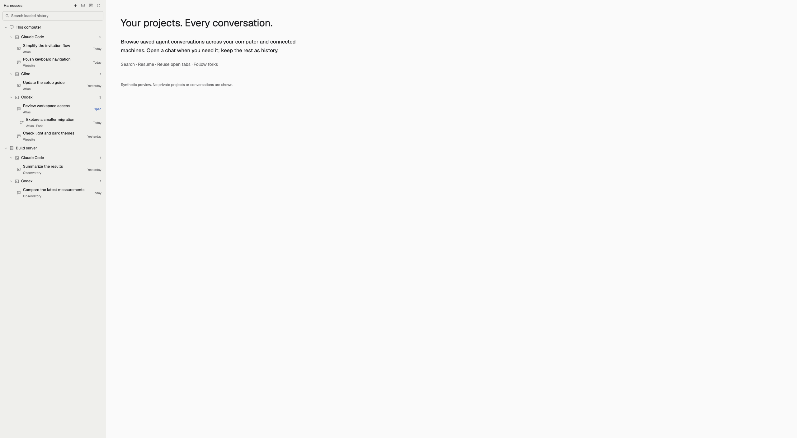

# Herdr Project History

A native sidebar showing connected machines, their projects and saved agent conversations. It follows Herdr's current theme and opens a conversation in its original agent, directory and machine.

## What you see

The panel occupies the existing Spaces region, initially 300 px wide and resizable. A 36 px header contains Projects or Harnesses, New space, grouping, archive view and refresh. A 30 px search field follows it. Machine rows are 32 px high, project/harness rows 31 px, and saved conversation rows 44 px with a title above the agent or project label. Dates and Open/Running states sit at the right. Known projects appear directly; unassigned working folders sit under Other history folders. Forks use a branch icon and indent up to three levels.

Use the current theme's chrome, foreground, muted, accent, selected and hover colors. Body text is 12.5 px; supplementary labels are 10–11.5 px. The panel does not replace the terminal or the separate Agents block. Below 160 px sidebar width it becomes a compact space-switching rail.

## How it behaves

Expand a machine to read its history. Collapsed remotes are not contacted automatically. Expanded machines refresh once a minute while the window is active. Missing dependencies, offline machines, reader errors and bounded history limits have distinct messages. A failed provider retains any previously loaded rows as stale history.

Expand a project to see 25 conversations at a time; Previous/Next change the page. Search matches project names, titles and configured agent labels across all loaded metadata. Up/Down and Enter navigate header controls and visible rows; Escape returns to the terminal. Right-click an existing project for Herdr's stock space menu.

The grouping popup selects By project or By harness. It supports Up/Down, Enter and Escape, and opens native Spaces navigation when requested. The preference persists in shared mod state; private `groupBy` configuration supplies the initial default. Harness grouping uses the same records, preserving the original project on every row and every resume action. Existing project order stays stable when focus changes.

Click a conversation to open a named tab, or a space if its project is not open. Opening passes no prompt. Existing matching Herdr terminals are focused instead. Fork ancestry is displayed only from explicit metadata. Chat UUIDs stay internal. Desktop-only and externally running Claude sessions are identified and are not blindly reopened.

Live working, blocked, done and idle states remain owned by Herdr's existing Agents mod; this panel does not invent those statuses for saved chats. A live terminal not matched to a saved row can appear beneath its open project. The panel's Opening state tracks a launch operation. Herdr supplies the agent's task status.

## Built from

Install the single `mods/project-history/` mod. Its JavaScript view uses `gpui-kit` and `gpui-base`; `model.js` groups metadata and constructs resume argument arrays. The provider registry is `providers.json`, merged with private overrides and Herdr's detected agents. `collector.py` reads metadata with Python's standard library, plus the optional official Claude Agent SDK. Custom history adapters return a normalized JSON array.

Herdr APIs: `spaces`, `machines`, `terminals`, `knownAgents`, `focused`, `theme`, `layout`, `window`, `exec`, `hc`, `readTextFile`, `appHome`, `nextCommand`, `run`, `openOverlay`. Commands: `space.new`, `space.select`, `tab.new`, `pane.focus`, and the stock `menu` mod. The mod labels terminals using `hc label` for later reuse.

In a personal layout, replace the Spaces block's `content.mod` with `project-history`; preserve the Agents, toolbar and terminal blocks. `install.py` does this in a clone. The mod's manifest uses `place: none`, so copying it does not silently dock a duplicate panel. No custom global shortcut is installed. The `focus`, `refresh` and `remotes` mod commands can be bound or invoked from a TUI.

Icons are small original SVGs in `icons/`. The `demo` property renders synthetic history without reading the computer. The `detail` property supplies a preview caption. Neither property belongs in a normal installation.

## Watch out

Do not edit shipped Herdr mods or layouts. Do not package any runtime data, personal provider settings, project maps, account identifiers, real conversation titles or screenshots of real terminals. Preview only with the synthetic `demo.js` data.

Codex and macOS Claude Desktop metadata formats are internal and need compatibility checks after upgrades. Claude Desktop session IDs differ from CLI session IDs: join on `cliSessionId`, and translate fork parents through the Desktop metadata map. A missing CLI transcript must not be imported or fabricated. Cloud-only Code, Chat and Cowork histories are outside this adapter.

Use argument arrays, explicit target machine/folder and validated IDs. Never add permission-bypass flags. Herdr's login-shell launch configuration must be preserved. Shell integration text can surround remote command output, so the reader frames it before parsing JSON. A timed-out history subprocess must lose its owned process group, not leave descendants running.

Herdr's live-data reads can re-render frequently. Group outside the short render callback, cache by snapshot and space structure, avoid rebuilding a candidate list per conversation, and do not render hundreds of unassigned folders by default. There are at most 5,000 records per provider. Search does not load collapsed remote histories.

Duplicate detection is based on session IDs in labels and launch arguments; an in-terminal session switch can make those identifiers stale. External Claude detection rechecks explicit session arguments before launch and remains best-effort. Preserve original histories and running work.

## Done when

- Synthetic model and collector tests pass, including provider isolation, migration-aware project membership, machine/provider identity, fork cycles, subprocess timeouts and Desktop metadata privacy.
- `herdr-app check ./mods/project-history` passes, and the actual app renders the deferred loaded state without errors.
- Search finds a real saved conversation, a click resumes it at its prompt, and another click reuses the existing Herdr terminal.
- Connected-machine history loads using the configured Python environment, and launches target that machine.
- Light and dark themes, keyboard navigation, empty searches, archive view and error recovery have been inspected.
- Owned test terminals and layouts are removed; only the installed mod, intended layout, source and documented runtime dependency remain.
